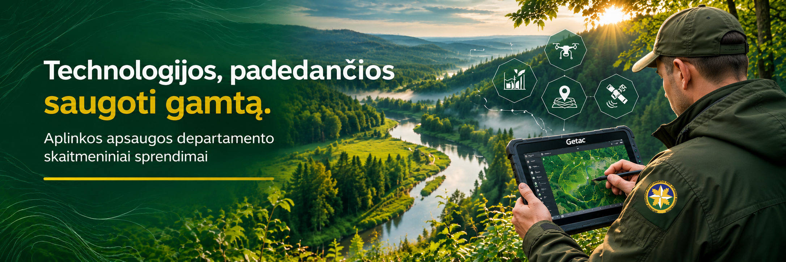

### Technologijos, padedančios saugoti gamtą

Kuriame ir tobuliname įrankius kasdieniam aplinkosaugos darbui: **veiklos planavimui, duomenų valdymui ir procesų automatizavimui.**

---

### Veiklos kryptys

| ⚙️ Procesų automatizavimas | 🗃️ Duomenų valdymas |
| :--- | :--- |
| Optimizuojame pasikartojančias užduotis ir mažiname rankinio darbo apimtis. | Kuriame priemones duomenims apdoroti, sisteminti ir analizuoti. |

| 📅 Veiklos planavimas | 💻 IT sprendimai |
| :--- | :--- |
| Tobuliname veiklos planavimo ir koordinavimo įrankius. | Kuriame bei diegiame skaitmenines priemones kasdieniams poreikiams. |

### Apie mus

**Aplinkos apsaugos departamentas prie Aplinkos ministerijos** vykdo aplinkos apsaugos valstybinės priežiūros funkcijas. Šiame GitHub profilyje pristatome skaitmeninius sprendimus, padedančius efektyvinti procesus ir palengvinti aplinkosaugos darbą.

**[Oficiali svetainė](https://aad.lrv.lt/)** · **[Projektų saugyklos](https://github.com/orgs/AAD-LT/repositories)**

---

<em>Technologijos gamtos apsaugai.</em>

